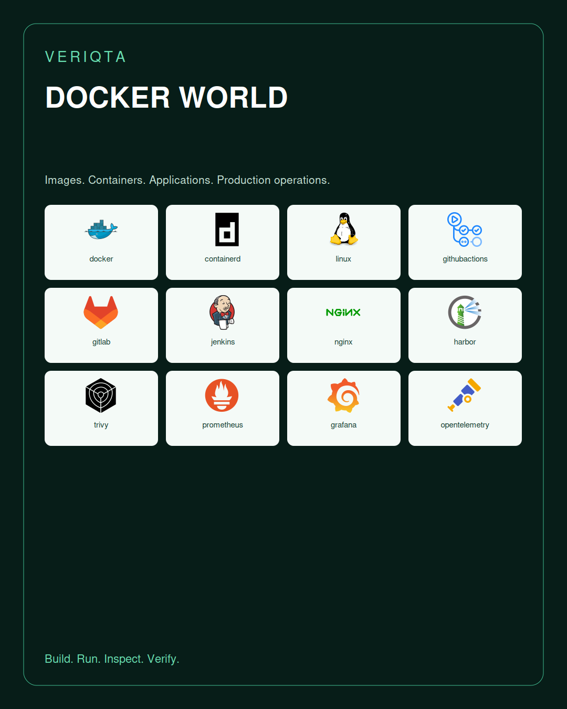
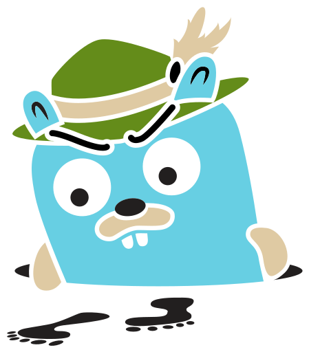
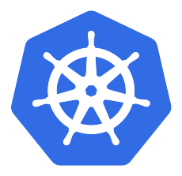
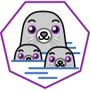
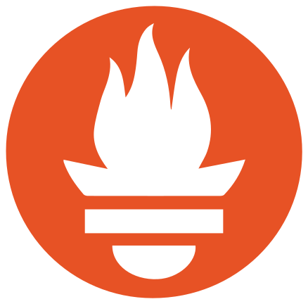
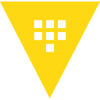
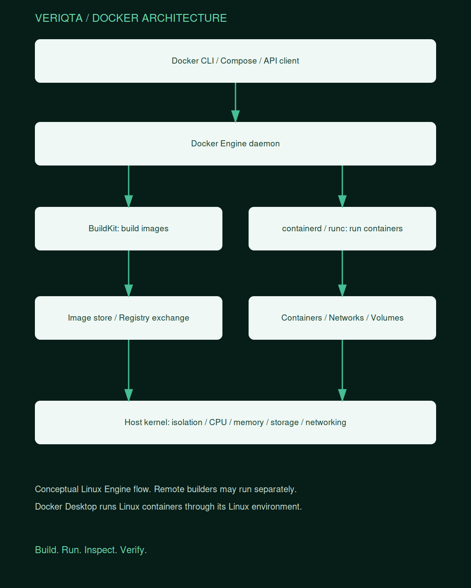

# DOCKER-WORLD

### Build the image. Understand the container. Operate the application.

DOCKER-WORLD is VERIQTA’s engineering hub for Docker and containerized applications. Explore the engine, images, builds, container lifecycle, Compose, networks, volumes, registries, security, observability, delivery, and production operations.

**Scaffold edition.** Public navigation, catalogues, and visual assets are available. Learning notes, labs, projects, interviews, scripts, and configuration templates are intentionally empty. Empty template files are reserved destinations and are not runnable examples.

## Choose your path

| Goal | Start here |
|---|---|
| Learn Docker from the beginning | [Container and Docker Foundations](02-Container-and-Docker-Foundations/) |
| Build reliable images | [Dockerfile and Image Design](08-Dockerfile-and-Image-Design/) |
| Run multi-container applications | [Docker Compose](17-Docker-Compose/) |
| Secure containers | [Security and Hardening](20-Security-and-Hardening/) |
| Investigate production failures | [Troubleshooting and Incidents](28-Troubleshooting-and-Incidents/) |
| Prepare for interviews | [Interview Preparation](37-Interview-Preparation/) |

## Explore Docker World

| Section | Topics |
|---|---|
| [00-Start-Here](00-Start-Here/) | How-to-Use, Learning-Paths, Lab-Setup, Compatibility, Cost-and-Cleanup, Evidence |
| [01-Beginner-to-Advanced](01-Beginner-to-Advanced/) | Junior, Mid-Level, Senior, Skills-Checklist |
| [02-Container-and-Docker-Foundations](02-Container-and-Docker-Foundations/) | Containers-vs-VMs, Images-vs-Containers, OCI, Namespaces, cgroups, Isolation, Immutable-Infrastructure |
| [03-Docker-Architecture](03-Docker-Architecture/) | CLI, REST-API, dockerd, containerd, runc, Moby, Client-Server, Execution-Flow, Image-Store |
| [04-Installation-and-Host-Setup](04-Installation-and-Host-Setup/) | Linux, Windows, macOS, Engine-Installation, Post-Install, Package-Repositories, Uninstall, Host-Requirements |
| [05-Docker-Desktop](05-Docker-Desktop/) | Settings, Linux-VM, WSL2, File-Sharing, Resources, Networking, Extensions, Organization-Policies, Troubleshooting |
| [06-CLI-Contexts-and-API](06-CLI-Contexts-and-API/) | CLI-Configuration, Contexts, Remote-Daemons, TLS, SSH, API-Versioning, SDKs, Events, Inspect, Formatting |
| [07-Images-and-Registries](07-Images-and-Registries/) | Layers, Tags, Digests, Pull, Push, Save-and-Load, Import-and-Export, Manifest-Lists, Image-History, Image-Store |
| [08-Dockerfile-and-Image-Design](08-Dockerfile-and-Image-Design/) | FROM, RUN, COPY-and-ADD, WORKDIR, USER, ENV-and-ARG, ENTRYPOINT-and-CMD, EXPOSE, VOLUME, HEALTHCHECK, STOPSIGNAL, SHELL, LABEL, ONBUILD, Dockerignore |
| [09-BuildKit-and-Buildx](09-BuildKit-and-Buildx/) | Builders, Drivers, Build-Contexts, Frontends, Cache-Mounts, Secret-Mounts, SSH-Mounts, Remote-Builders, Exporters, Importers, Bake, Build-Checks |
| [10-Build-Performance-and-Reproducibility](10-Build-Performance-and-Reproducibility/) | Layer-Ordering, Cache-Invalidation, Registry-Cache, CI-Cache, Dependency-Pinning, Deterministic-Builds, Build-Profiling |
| [11-Multi-Stage-and-Multi-Platform](11-Multi-Stage-and-Multi-Platform/) | Multi-Stage, Build-Targets, Cross-Compilation, QEMU, Native-Builders, Platform-Selection, Manifest-Inspection |
| [12-Container-Lifecycle](12-Container-Lifecycle/) | Create, Run, Start, Stop, Restart, Kill, Pause, Exec, Attach, Copy, Remove, Exit-Codes, Restart-Policies |
| [13-Processes-Signals-and-Health](13-Processes-Signals-and-Health/) | PID1, Signal-Forwarding, Init, Zombies, Graceful-Shutdown, Healthchecks, Readiness-vs-Health, Application-Retries |
| [14-Resource-Management](14-Resource-Management/) | CPU, Memory, Swap, OOM, PIDs, Ulimits, Shared-Memory, GPU, Devices, cgroups, Resource-Accounting |
| [15-Networking](15-Networking/) | Bridge, Host, None, Overlay, Macvlan, IPvlan, DNS, Port-Publishing, IPv6, Firewall, Routing, Network-Inspection |
| [16-Storage-and-Persistence](16-Storage-and-Persistence/) | Volumes, Bind-Mounts, Tmpfs, Permissions, Volume-Drivers, Copy-Up, Image-Storage, Disk-Usage, Data-Lifecycle |
| [17-Docker-Compose](17-Docker-Compose/) | Compose-Specification, Services, Networks, Volumes, Configs, Secrets, Projects, Profiles, Interpolation, Merge, Include, Watch, Develop, Dependency-Conditions |
| [18-Compose-Application-Patterns](18-Compose-Application-Patterns/) | Web-and-Database, Workers-and-Queues, Reverse-Proxy, Observability-Stack, Local-Development, Test-Environments, Production-Overrides |
| [19-Docker-Hub-and-Registry-Operations](19-Docker-Hub-and-Registry-Operations/) | Repositories, Namespaces, Organizations, Teams, Access-Tokens, Pull-Limits, Retention, Mirrors, Private-Registry, Harbor, OCI-Distribution |
| [20-Security-and-Hardening](20-Security-and-Hardening/) | Threat-Model, Non-Root, Capabilities, Seccomp, AppArmor, SELinux, Read-Only, Privileged-Mode, Docker-Socket, Daemon-Access, User-Namespaces |
| [21-Rootless-Docker](21-Rootless-Docker/) | Prerequisites, Installation, Networking, Storage, Systemd, Cgroup-Limits, Rootless-BuildKit, Limitations |
| [22-Secrets-Identity-and-Supply-Chain](22-Secrets-Identity-and-Supply-Chain/) | Build-Secrets, Runtime-Secrets, Credential-Helpers, Image-Scanning, SBOM, Provenance, Signing, Policy, Dependency-Risk |
| [23-Docker-Scout-and-Image-Policy](23-Docker-Scout-and-Image-Policy/) | Image-Analysis, Vulnerability-Triage, Recommendations, Policy-Evaluation, CI-Integration, Compatibility-and-Entitlements |
| [24-Logging-and-Observability](24-Logging-and-Observability/) | Logging-Drivers, Local-and-JSON-File, Rotation, Docker-Logs, Metrics, Docker-Stats, Prometheus, Grafana, OpenTelemetry, Loki, Tracing, Alerts |
| [25-CI-CD-and-Release](25-CI-CD-and-Release/) | GitHub-Actions, GitLab-CI, Jenkins, Build-and-Push, Testcontainers, Promotion, Digest-Pinning, Rollback, Ephemeral-Runners |
| [26-Docker-Swarm](26-Docker-Swarm/) | Managers-and-Workers, Raft, Services, Tasks, Stacks, Secrets, Configs, Overlay, Routing-Mesh, Placement, Rolling-Updates, Autolock, Quorum |
| [27-Production-Operations](27-Production-Operations/) | Operational-Readiness, Systemd, Daemon-Configuration, Live-Restore, Maintenance, Upgrades, Patch-Management, Capacity, Host-Monitoring |
| [28-Troubleshooting-and-Incidents](28-Troubleshooting-and-Incidents/) | Container-Exits, OOMKilled, Signal-Failures, Port-Conflicts, DNS, Permission-Denied, Disk-Full, Build-Failures, Pull-Failures, Unhealthy, Daemon-Failures, Swarm-Quorum |
| [29-Backup-and-Recovery](29-Backup-and-Recovery/) | Volume-Backup, Database-Consistency, Restore-Testing, Registry-Backup, Swarm-State, Host-Rebuild, Recovery-Objectives |
| [30-Performance-and-Cost](30-Performance-and-Cost/) | Image-Size, Startup-Time, Build-Time, CPU-Throttling, Memory, IO, Network, Idle-Resources, Registry-Costs, Build-Costs |
| [31-Windows-and-Cross-Platform](31-Windows-and-Cross-Platform/) | Windows-Containers, Linux-Containers, Isolation-Modes, Base-Image-Compatibility, WSL2, Path-and-Line-Endings, Architecture-Compatibility |
| [32-Cloud-and-Orchestrator-Integration](32-Cloud-and-Orchestrator-Integration/) | AWS, Azure, Google-Cloud, Kubernetes, ECS, Container-Apps, Cloud-Run, Registry-Authentication, Runtime-Boundaries |
| [33-Docker-Products-and-New-Workflows](33-Docker-Products-and-New-Workflows/) | Build-Cloud, Hardened-Images, Docker-Offload, Docker-Model-Runner, Docker-Sandboxes, MCP-Toolkit, Availability-and-Entitlements |
| [34-Architecture-Patterns](34-Architecture-Patterns/) | Stateless-App, Stateful-App, Event-Driven, Batch, Reverse-Proxy, Single-Host, Swarm-Cluster, CI-Build-Farm |
| [35-Projects](35-Projects/) | Junior, Mid-Level, Senior, Portfolio-Capstones |
| [36-Labs](36-Labs/) | Junior, Mid-Level, Senior |
| [37-Interview-Preparation](37-Interview-Preparation/) | Junior, Mid-Level, Senior, Architecture-Discussions |
| [38-Engineer-Notebooks](38-Engineer-Notebooks/) | Standards, Evidence-and-Redaction, Junior, Mid-Level, Senior |
| [39-Toolkit-and-Templates](39-Toolkit-and-Templates/) | CLI-Cheat-Sheets, Dockerfiles, Compose, Buildx-Bake, Daemon-Configuration, Diagnostics, Cleanup |
| [40-Docker-Resource-Catalog](40-Docker-Resource-Catalog/) | Engine-Objects, Compose-Model, Swarm-Objects, Build-Objects, Registry-Artifacts |
| [41-Tool-and-Integration-Catalog](41-Tool-and-Integration-Catalog/) | Selection, Compatibility, Integration-Boundaries |
| [42-Resources-and-Community](42-Resources-and-Community/) | Official-Documentation, CLI-Reference, API-Reference, Compose-Reference, Release-Notes, OCI, Glossary |
| [43-Versioning-and-Lifecycle](43-Versioning-and-Lifecycle/) | Compatibility-Matrix, Feature-Availability, Deprecations, Migration, Support-and-Policy |

## Docker resource catalogue

Engine objects, Compose model elements, Swarm objects, build concepts, and registry artifacts have distinct lifecycles. This directory keeps those boundaries visible.

| Category | Resources and concepts |
|---|---|
| [Engine-Objects](40-Docker-Resource-Catalog/Engine-Objects/) | Container, Image, Network, Volume, Plugin, Exec-Session, Context |
| [Compose-Model](40-Docker-Resource-Catalog/Compose-Model/) | Project, Service, Network, Volume, Config, Secret, Profile, Build-Definition, Develop-Definition |
| [Swarm-Objects](40-Docker-Resource-Catalog/Swarm-Objects/) | Swarm, Node, Service, Task, Stack, Secret, Config |
| [Build-Objects](40-Docker-Resource-Catalog/Build-Objects/) | Builder, Build-Context, Build-Target, Cache, Build-Result, Build-Attestation, Bake-Target |
| [Registry-Artifacts](40-Docker-Resource-Catalog/Registry-Artifacts/) | Repository, Tag, Manifest, Image-Index, Blob, SBOM, Provenance |

## Docker components and products

The Docker project mark below identifies the Docker ecosystem. It does not represent a unique logo for every component. Product availability, licensing, platform support, and entitlements vary.

| Component or product | Ecosystem mark | Learning folder |
|---|---|---|
| Docker Engine |  | [Explore](41-Tool-and-Integration-Catalog/Docker-Engine/) |
| Docker CLI |  | [Explore](41-Tool-and-Integration-Catalog/Docker-CLI/) |
| Docker Desktop |  | [Explore](41-Tool-and-Integration-Catalog/Docker-Desktop/) |
| Docker Compose |  | [Explore](41-Tool-and-Integration-Catalog/Docker-Compose/) |
| BuildKit |  | [Explore](41-Tool-and-Integration-Catalog/BuildKit/) |
| Buildx |  | [Explore](41-Tool-and-Integration-Catalog/Buildx/) |
| Bake |  | [Explore](41-Tool-and-Integration-Catalog/Bake/) |
| Docker Hub |  | [Explore](41-Tool-and-Integration-Catalog/Docker-Hub/) |
| Docker Scout |  | [Explore](41-Tool-and-Integration-Catalog/Docker-Scout/) |
| Docker Build Cloud |  | [Explore](41-Tool-and-Integration-Catalog/Docker-Build-Cloud/) |
| Docker Hardened Images |  | [Explore](41-Tool-and-Integration-Catalog/Docker-Hardened-Images/) |
| Docker Offload |  | [Explore](41-Tool-and-Integration-Catalog/Docker-Offload/) |
| Docker Model Runner |  | [Explore](41-Tool-and-Integration-Catalog/Docker-Model-Runner/) |
| Docker Sandboxes |  | [Explore](41-Tool-and-Integration-Catalog/Docker-Sandboxes/) |
| Docker MCP Toolkit |  | [Explore](41-Tool-and-Integration-Catalog/Docker-MCP-Toolkit/) |

## Tools and integrations

These tools are optional integrations, dependencies, or comparison subjects. They are not all Docker products.

| Tool | Project or vendor mark | Learning folder |
|---|---|---|
| amazonwebservices |  | [Explore](41-Tool-and-Integration-Catalog/amazonwebservices/) |
| azure |  | [Explore](41-Tool-and-Integration-Catalog/azure/) |
| bash |  | [Explore](41-Tool-and-Integration-Catalog/bash/) |
| containerd |  | [Explore](41-Tool-and-Integration-Catalog/containerd/) |
| git |  | [Explore](41-Tool-and-Integration-Catalog/git/) |
| github |  | [Explore](41-Tool-and-Integration-Catalog/github/) |
| githubactions |  | [Explore](41-Tool-and-Integration-Catalog/githubactions/) |
| gitlab |  | [Explore](41-Tool-and-Integration-Catalog/gitlab/) |
| go |  | [Explore](41-Tool-and-Integration-Catalog/go/) |
| googlecloud |  | [Explore](41-Tool-and-Integration-Catalog/googlecloud/) |
| grafana |  | [Explore](41-Tool-and-Integration-Catalog/grafana/) |
| harbor |  | [Explore](41-Tool-and-Integration-Catalog/harbor/) |
| jaeger |  | [Explore](41-Tool-and-Integration-Catalog/jaeger/) |
| jenkins |  | [Explore](41-Tool-and-Integration-Catalog/jenkins/) |
| kubernetes |  | [Explore](41-Tool-and-Integration-Catalog/kubernetes/) |
| linux |  | [Explore](41-Tool-and-Integration-Catalog/linux/) |
| loki |  | [Explore](41-Tool-and-Integration-Catalog/loki/) |
| nginx |  | [Explore](41-Tool-and-Integration-Catalog/nginx/) |
| opentelemetry |  | [Explore](41-Tool-and-Integration-Catalog/opentelemetry/) |
| podman |  | [Explore](41-Tool-and-Integration-Catalog/podman/) |
| prometheus |  | [Explore](41-Tool-and-Integration-Catalog/prometheus/) |
| python |  | [Explore](41-Tool-and-Integration-Catalog/python/) |
| trivy |  | [Explore](41-Tool-and-Integration-Catalog/trivy/) |
| vault |  | [Explore](41-Tool-and-Integration-Catalog/vault/) |

## Under the hood

## Visual library

| Visual | Open |
|---|---|
| resources 01 | [View](assets/galleries/resources-01.png) |
| resources 02 | [View](assets/galleries/resources-02.png) |
| tools 01 | [View](assets/galleries/tools-01.png) |
| tools 02 | [View](assets/galleries/tools-02.png) |

## Practice and demonstrate

Choose a learning path, explore the relevant resources, and build a lab with verification, failure investigation, and cleanup. Use the project folders for portfolio work and the interview section to explain decisions and tradeoffs.

## Scope and compatibility

The repository covers the major Docker engineering areas and surrounding workflows. It does not claim to enumerate every CLI flag, API field, third-party plugin, or cloud service. Compose configuration concepts are not all Engine objects. Swarm has its own cluster model. Kubernetes and cloud integrations have separate runtime and scheduling models.

Newer Docker products and workflows require checks against their current documentation and your installed versions. Historical and deprecated workflows belong in migration context.

## Official references

- [Docker documentation](https://docs.docker.com/)
- [Docker Engine](https://docs.docker.com/engine/)
- [Docker build](https://docs.docker.com/build/)
- [Compose](https://docs.docker.com/compose/)
- [CLI reference](https://docs.docker.com/reference/cli/docker/)
- [Dockerfile reference](https://docs.docker.com/reference/dockerfile/)
- [Compose specification](https://docs.docker.com/reference/compose-file/)
- [Swarm](https://docs.docker.com/engine/swarm/)
- [Security](https://docs.docker.com/engine/security/)

[Asset attribution](assets/ATTRIBUTION.md) | [Scaffold notes](docs/SCAFFOLD-NOTES.md)

## VERIQTA

Practical container engineering through clear explanations, inspectable systems, and verified results.
